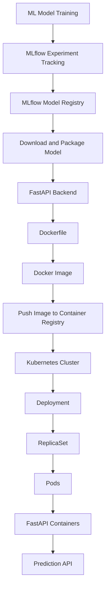
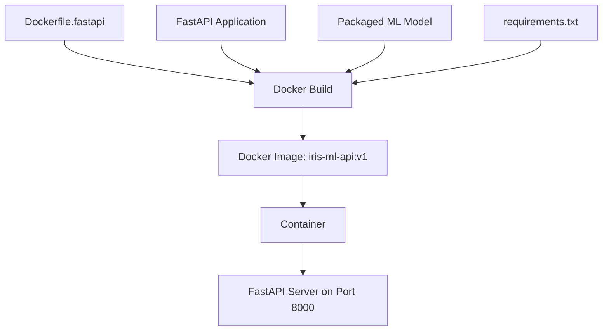
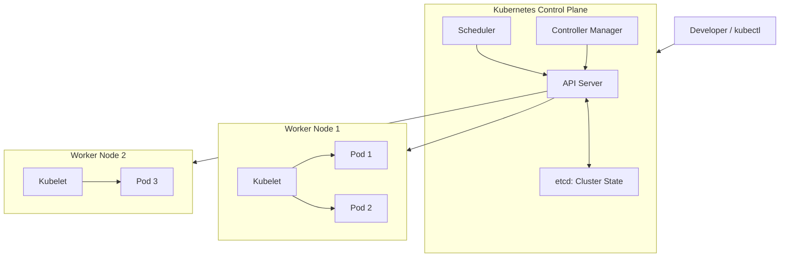
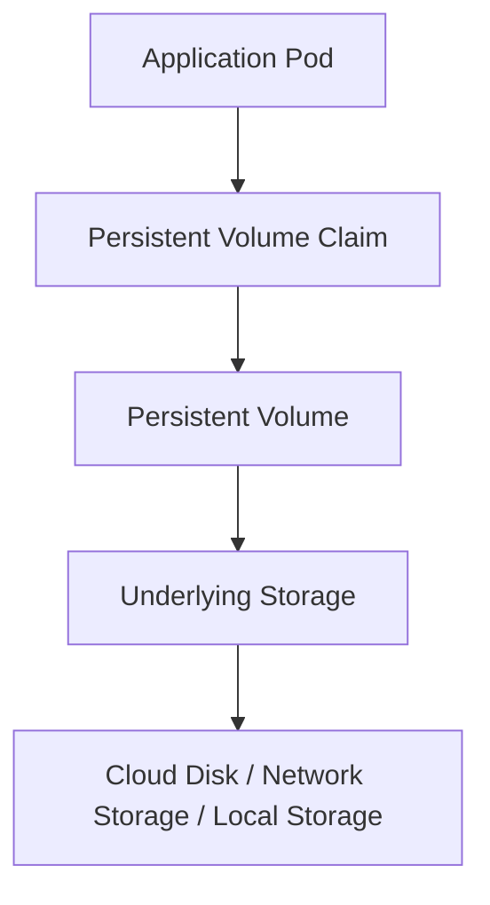
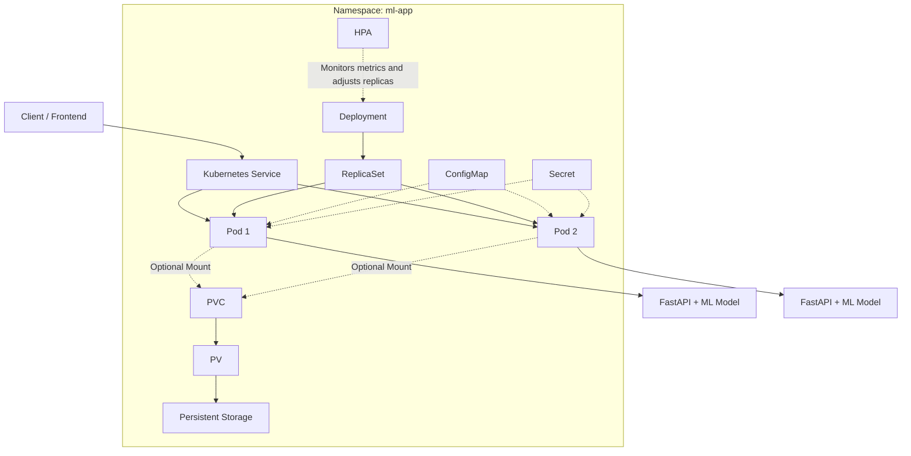
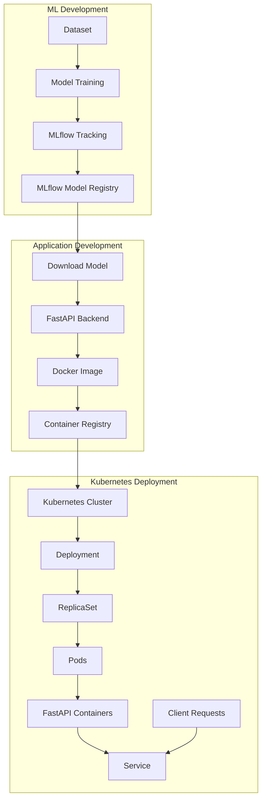

# Kubernetes for ML Model Deployment

## 1. Introduction

Kubernetes is an open-source container orchestration platform used to deploy, manage, scale, and maintain containerized applications.

It manages application containers across a cluster of machines and provides:

- Application deployment and management.
- Automatic replacement of failed Pods.
- Scaling of application instances.
- Service discovery and load balancing.
- Configuration and secret management.
- Persistent storage integration.
- Rolling updates and rollbacks.

**Important:** Kubernetes does not train ML models, package Python applications, or build Docker images. Those tasks happen before Kubernetes deployment.

---

# 2. Complete ML Deployment Architecture

Our objective is to deploy an Iris classification model as a FastAPI application using Docker and Kubernetes.

## End-to-end flow



### Stage 1: ML Model Training

We first train our machine learning model using our training pipeline.

Example:

- Dataset: Iris dataset.
- Algorithm: Random Forest Classifier.
- Features: Sepal length, sepal width, petal length, petal width.
- Output: Predicted Iris class.

The training process produces a trained model.

### Stage 2: MLflow Experiment Tracking

MLflow tracks the experiments performed during model training.

It stores:

- Model parameters.
- Evaluation metrics.
- Run information.
- Model artifacts.

This allows us to compare experiments and identify suitable models.

### Stage 3: MLflow Model Registry

The Model Registry manages registered models and their versions.

For example:

```text
Iris_RF_Classifier
    |
    |-- Version 1
    |-- Version 2
    |-- Version 3
    |-- Version 4
```

We select the model version we want to deploy.

### Stage 4: Model Packaging

We download the selected model version from MLflow.

Example:

```python
import mlflow

model_uri = "models:/Iris_RF_Classifier/4"

local_path = mlflow.artifacts.download_artifacts(
    artifact_uri=model_uri,
    dst_path="artifacts/packaged_model"
)
```

The downloaded model package contains the model artifacts and associated environment information.

**Important:** A model package is not a complete application. It does not automatically contain our FastAPI backend, the complete application runtime, or every external service it might need.

We must also ensure that preprocessing and feature engineering used during prediction match training.

### Stage 5: FastAPI Backend

FastAPI provides an HTTP API through which other applications can request predictions.

Our application:

1. Receives input measurements.
2. Validates the input using Pydantic.
3. Creates the required input DataFrame.
4. Applies feature engineering.
5. Passes the input to the trained model.
6. Returns the prediction as JSON.

Example endpoint:

```text
POST /predict
```

Example request:

```json
{
    "sepal_length": 5.1,
    "sepal_width": 3.5,
    "petal_length": 1.4,
    "petal_width": 0.2
}
```

Example response:

```json
{
    "prediction": 0
}
```

Uvicorn runs our FastAPI application.

Local execution:

```bash
uvicorn app.main:app --reload --port 8000
```

Swagger documentation:

```text
http://localhost:8000/docs
```

At this stage, our API can run without Docker or Kubernetes.

---

# 3. Docker: Packaging the Application

## What is Docker?

Docker is a platform used to package applications and their required runtime dependencies into container images.

It helps maintain a consistent application environment across different machines.

## Docker Image

A Docker image is a packaged template containing the application code, runtime, dependencies, model files, and other required files.

## Docker Container

A Docker container is a running instance created from a Docker image.

One image can create multiple containers.

## Our Docker project structure

```text
Week8_MLOps_HandsOn/
│
├── app/
│   ├── __init__.py
│   └── main.py
│
├── artifacts/
│   └── packaged_model/
│
├── src/
│
├── requirements.txt
│
├── Dockerfile
├── Dockerfile.fastapi
│
└── .dockerignore
```

## Dockerfile.fastapi

```dockerfile
# Base Python runtime
FROM python:3.11

# Working directory inside the image
WORKDIR /app

# Copy dependency file
COPY requirements.txt .

# Install Python dependencies
RUN pip install --no-cache-dir -r requirements.txt

# Copy FastAPI application
COPY app/ ./app/

# Copy packaged MLflow model
COPY artifacts/ ./artifacts/

# Document the application port
EXPOSE 8000

# Start FastAPI using Uvicorn
CMD ["uvicorn", "app.main:app", "--host", "0.0.0.0", "--port", "8000"]
```

### What happens during the Docker build?



Build command:

```bash
docker build -f Dockerfile.fastapi -t iris-ml-api:v1 .
```

Run command:

```bash
docker run -p 8000:8000 iris-ml-api:v1
```

Our FastAPI application is now running inside a Docker container.

### Why do we need Docker before Kubernetes?

Kubernetes primarily manages containerized workloads. It needs a container image that it can run.

Docker helps us package our application into that image.

**Important:** Kubernetes does not require Docker Engine specifically. It can run compatible container images using container runtimes such as containerd or CRI-O.

## Docker Image Registry

After building the image, we need to make it accessible to the Kubernetes cluster.

A container registry stores and distributes container images.

Examples:

- Docker Hub.
- Amazon Elastic Container Registry (ECR).
- Azure Container Registry (ACR).
- Google Artifact Registry.

Typical workflow:

```text
Build Docker Image
       |
       v
Tag Docker Image
       |
       v
Push Image to Registry
       |
       v
Kubernetes Pulls Image
```

Example:

```bash
docker tag iris-ml-api:v1 username/iris-ml-api:v1

docker push username/iris-ml-api:v1
```

The Kubernetes Deployment must reference an image that the cluster can access.

For private registries, the cluster also needs appropriate image-pull credentials.

---

# 4. Kubernetes Fundamentals

## What is Kubernetes?

Kubernetes is a container orchestration platform that manages the deployment and lifecycle of containerized applications.

It continuously works toward the desired state specified in Kubernetes configuration files.

For example:

If we request two application Pods and one Pod fails, Kubernetes can create a replacement to maintain the desired replica count.

## Kubernetes Architecture



### Control Plane

The Control Plane manages the Kubernetes cluster.

Main components:

**API Server**

- Entry point for Kubernetes API requests.
- Receives and validates resource configuration.
- Communicates with other control-plane components.

**Scheduler**

- Selects suitable worker nodes for newly created Pods.
- Considers available resources and scheduling requirements.

**Controller Manager**

- Runs controllers that continuously compare actual state with desired state.
- Helps maintain the requested number and state of resources.

**etcd**

- Distributed key-value store.
- Stores Kubernetes cluster state and configuration data.

### Worker Nodes

Worker nodes run application workloads.

**Kubelet**

- Communicates with the Control Plane.
- Ensures assigned Pods are running as specified.

**Container Runtime**

- Runs containers.
- Examples: containerd and CRI-O.

**Pods**

- Smallest deployable units in Kubernetes.
- A Pod contains one or more containers that share networking and can share storage.

---

# 5. Important Kubernetes Resources

## 5.1 Cluster

A Kubernetes cluster is a group of machines managed by Kubernetes.

It contains the Control Plane and Worker Nodes.

## 5.2 Node

A Node is a machine in the Kubernetes cluster.

It can be a physical machine or a virtual machine.

## 5.3 Pod

A Pod is the smallest deployable unit in Kubernetes.

It contains one or more containers.

For our application:

```text
Pod
 |
 |-- FastAPI Container
       |
       |-- Python Runtime
       |-- FastAPI Application
       |-- Packaged ML Model
       |-- Dependencies
```

## 5.4 Deployment

A Deployment manages the desired number of application Pods.

It provides:

- Replica management.
- Rolling updates.
- Replacement of failed Pods through its ReplicaSet.
- Declarative application updates.

## 5.5 ReplicaSet

A ReplicaSet ensures that the requested number of Pod replicas exists.

Relationship:

```text
Deployment
    |
    v
ReplicaSet
    |
    v
Pods
    |
    v
Containers
```

In normal application management, we create Deployments rather than managing ReplicaSets directly.

## 5.6 Service

A Service provides a stable network endpoint for accessing a group of Pods.

Why is it needed?

Pod IP addresses can change when Pods are replaced.

A Service provides a stable address and forwards traffic to eligible Pods.

### Service Types

| Type | Purpose |
|---|---|
| ClusterIP | Internal access within the cluster. |
| NodePort | Exposes the Service through a port on cluster nodes. |
| LoadBalancer | Requests an external load balancer, usually through a cloud provider integration. |

For our initial ML application, ClusterIP is sufficient if other applications inside the cluster need to call our API.

For external access, we can use a LoadBalancer Service or an Ingress/Gateway setup.

---

# 6. Kubernetes Configuration and Storage

## 6.1 YAML Manifests

A YAML manifest defines a Kubernetes resource and its desired configuration.

Kubernetes uses these manifests to create and manage resources.

Our manifests are stored in:

```text
kubernetes/
```

## 6.2 Namespace

A Namespace provides logical separation of resources inside a Kubernetes cluster.

Example:

```text
Kubernetes Cluster
    |
    |-- Namespace: ml-app
    |      |-- Deployment
    |      |-- Service
    |      |-- ConfigMap
    |      |-- Secret
    |
    |-- Namespace: frontend-app
           |-- Deployment
           |-- Service
```

Namespaces help organize resources and establish administrative boundaries. They do not create separate clusters or automatically guarantee security isolation.

## 6.3 ConfigMap

A ConfigMap stores non-sensitive configuration data separately from application code.

Example:

```yaml
apiVersion: v1
kind: ConfigMap

metadata:
  name: iris-ml-config
  namespace: ml-app

data:
  APP_ENV: "production"
  MODEL_PATH: "artifacts/packaged_model"
```

Possible configuration values:

- Application environment.
- Model path.
- API configuration.
- Feature flags.

The application must be written to read these values. Kubernetes does not automatically change hardcoded Python variables.

## 6.4 Secret

A Secret stores sensitive configuration such as:

- Database passwords.
- API keys.
- Authentication tokens.

Example:

```yaml
apiVersion: v1
kind: Secret

metadata:
  name: iris-ml-secret
  namespace: ml-app

type: Opaque

stringData:
  DB_USERNAME: "mongo_user"
  DB_PASSWORD: "replace-with-real-secret"
```

`stringData` allows us to provide plain-text values in the manifest; Kubernetes converts them into the Secret's data representation.

**Security warning:** Base64 encoding is not encryption. Secrets need appropriate access controls and encryption-at-rest configuration. Do not commit real credentials to Git.

## 6.5 Persistent Volume (PV)

A Persistent Volume represents storage available to Kubernetes independently of an individual Pod's lifecycle.

Storage can come from:

- Cloud block storage.
- Network storage.
- Cluster storage systems.
- Local storage.

Example:

```yaml
apiVersion: v1
kind: PersistentVolume

metadata:
  name: iris-ml-pv

spec:
  capacity:
    storage: 1Gi

  accessModes:
    - ReadWriteOnce

  storageClassName: manual

  hostPath:
    path: "/mnt/data/iris-ml"
    type: DirectoryOrCreate
```

This is a local learning example, not a production storage recommendation.

## 6.6 Persistent Volume Claim (PVC)

A PVC is a storage request made by an application.

Example:

```yaml
apiVersion: v1
kind: PersistentVolumeClaim

metadata:
  name: iris-ml-pvc
  namespace: ml-app

spec:
  accessModes:
    - ReadWriteOnce

  storageClassName: manual

  resources:
    requests:
      storage: 1Gi
```

### PV and PVC relationship



- PV represents available storage.
- PVC requests storage.
- Kubernetes binds a suitable PV to a PVC, or dynamically provisions storage when configured.
- A Pod mounts the PVC to access the storage.

### StorageClass

A StorageClass describes how storage can be dynamically provisioned.

Examples of cloud-backed storage:

- AWS EBS.
- Azure Disk.
- Google Persistent Disk.

Example:

```yaml
storageClassName: gp3
```

This works only if the Kubernetes cluster has an appropriate StorageClass and storage provisioner configured.

**Important:** PV/PVC are required only when the application needs persistent storage. Our current Iris model inference API does not inherently need a PVC because its packaged model is already included in the Docker image.

---

# 7. Production Concepts

## 7.1 Liveness Probe

A liveness probe checks whether a container is still functioning.

If it repeatedly fails, Kubernetes can restart the container.

## 7.2 Readiness Probe

A readiness probe checks whether a container is ready to receive traffic.

If it fails, the Pod is removed from the Service's eligible endpoints until it becomes ready again.

Example for FastAPI:

```yaml
livenessProbe:
  httpGet:
    path: /health
    port: 8000
  initialDelaySeconds: 15
  periodSeconds: 10

readinessProbe:
  httpGet:
    path: /health
    port: 8000
  initialDelaySeconds: 5
  periodSeconds: 5
```

Our FastAPI application must actually implement `/health` for these probes to work.

## 7.3 Horizontal Pod Autoscaler (HPA)

HPA automatically adjusts the number of Pod replicas based on observed metrics.

Example:

```yaml
apiVersion: autoscaling/v2
kind: HorizontalPodAutoscaler

metadata:
  name: iris-ml-hpa
  namespace: ml-app

spec:
  scaleTargetRef:
    apiVersion: apps/v1
    kind: Deployment
    name: iris-ml-api

  minReplicas: 2
  maxReplicas: 5

  metrics:
    - type: Resource
      resource:
        name: cpu
        target:
          type: Utilization
          averageUtilization: 70
```

Example:

```text
Low CPU Usage  -> 2 Pods
High CPU Usage -> 4 Pods
Maximum        -> 5 Pods
```

HPA requires an available metrics source, such as Metrics Server.

For CPU utilization-based scaling, CPU resource requests must be configured on the application container.

When HPA manages a Deployment, avoid repeatedly applying a fixed replica count from the Deployment manifest, as this can conflict with HPA's scaling decisions.

## 7.4 Resource Requests and Limits

Kubernetes allows us to define CPU and memory requirements for containers.

**Requests**

The resources Kubernetes uses when scheduling Pods.

**Limits**

The maximum CPU or memory resources a container is allowed to consume.

Example:

```yaml
resources:
  requests:
    memory: "256Mi"
    cpu: "250m"

  limits:
    memory: "512Mi"
    cpu: "500m"
```

These are illustrative values. Actual resource settings should be based on application measurements, especially ML model memory usage and inference load.

## 7.5 Rolling Updates and Rollbacks

Rolling updates gradually replace old application Pods with new ones.

Example:

```text
Old Image: iris-ml-api:v1
        |
        v
Update Deployment
        |
        v
New Image: iris-ml-api:v2
        |
        v
Gradually replace old Pods
        |
        v
New version running
```

If a deployment update causes problems, Kubernetes supports rolling back to a previous Deployment revision.

---

# 8. Kubernetes YAML Files in Our Project

Our current folder:

```text
kubernetes/
│
├── namespace.yaml
├── deployment.yaml
├── service.yaml
├── configmap.yaml
├── secret.yaml
├── persistent-volume.yaml
├── persistent-volume-claim.yaml
└── hpa.yaml
```

### Purpose of each file

| File | Purpose | Required? |
|---|---|---|
| namespace.yaml | Creates the application namespace | Optional |
| deployment.yaml | Defines and manages application Pods | Yes |
| service.yaml | Provides stable network access | Needed for stable Service-based access |
| configmap.yaml | Stores non-sensitive configuration | Conditional |
| secret.yaml | Stores sensitive configuration | Conditional |
| persistent-volume.yaml | Defines available persistent storage | Conditional |
| persistent-volume-claim.yaml | Requests persistent storage | Conditional |
| hpa.yaml | Configures automatic replica scaling | Optional |

These are our core learning manifests, not a complete production configuration.

For a functional deployment, the manifests must be connected correctly.

For example:

- The Deployment must use the ConfigMap and Secret if the application needs them.
- The Deployment must mount the PVC if persistent storage is required.
- The Service selector must match the Pod labels.
- The HPA must target the correct Deployment.
- The image must be accessible to the cluster.

---

# 9. How All Kubernetes Components Work Together

This is the architecture of our FastAPI ML application inside Kubernetes.



### Request flow

1. A client sends an HTTP request.
2. The Kubernetes Service receives the request.
3. The Service forwards it to an eligible FastAPI Pod.
4. The FastAPI application validates the input.
5. The application applies preprocessing and feature engineering.
6. The packaged ML model generates a prediction.
7. The application returns the prediction as JSON.
8. The response reaches the client.

The Service does not understand ML predictions. It only handles network traffic to the Pods.

---

# 10. Practical Deployment: From Start to Finish

Now let's connect all the stages.

## Step 1: Train the model

Run our ML pipeline.

Output:

```text
Trained Iris Random Forest Model
```

## Step 2: Track and register the model

Use MLflow to track experiments and register the selected model version.

## Step 3: Package the model

Download the selected registered version into:

```text
artifacts/packaged_model/
```

Ensure preprocessing and dependency versions are compatible.

## Step 4: Create the FastAPI application

Create:

```text
app/main.py
```

Load the packaged model and define the `/predict` endpoint.

Test locally before containerizing.

## Step 5: Build the Docker image

Use:

```text
Dockerfile.fastapi
```

Build:

```bash
docker build -f Dockerfile.fastapi -t iris-ml-api:v1 .
```

## Step 6: Push the image to a registry

Tag and push the image to Docker Hub or another registry accessible to the cluster.

## Step 7: Configure Kubernetes YAML files

Create the required manifests:

- Namespace.
- Deployment.
- Service.
- ConfigMap and Secret if required.
- PV/PVC if persistent storage is required.
- HPA if automatic scaling is required.

Connect all the resources correctly.

## Step 8: Deploy to Kubernetes

Example command:

```bash
kubectl apply -f kubernetes/namespace.yaml
kubectl apply -f kubernetes/
```

The namespace is created first. The remaining manifests are applied afterward.

The Deployment references the Docker image, and Kubernetes pulls the image when needed.

## Step 9: Kubernetes creates and manages the application

```text
Kubernetes Cluster
       |
       v
Deployment
       |
       v
ReplicaSet
       |
       v
Pods
       |
       v
FastAPI Containers
       |
       v
Running ML Prediction API
```

## Step 10: Access and monitor the application

Useful commands:

```bash
kubectl get namespaces

kubectl get pods -n ml-app

kubectl get deployments -n ml-app

kubectl get services -n ml-app

kubectl get hpa -n ml-app

kubectl describe pod <pod-name> -n ml-app

kubectl logs <pod-name> -n ml-app
```

For local testing, we can forward a local port to the Kubernetes Service:

```bash
kubectl port-forward service/iris-ml-service 8000:8000 -n ml-app
```

Then access:

```text
http://localhost:8000/docs
```

---

# 11. What Is Actually Required vs Optional?

This distinction is important.

| Component | Status | Reason |
|---|---|---|
| Trained ML model | Required | Provides prediction capability |
| FastAPI application | Required for our API-based deployment | Exposes the model through HTTP |
| Docker image | Required for this containerized workflow | Packages the application |
| Container registry | Required when the cluster cannot directly access the image | Makes the image available to worker nodes |
| Kubernetes cluster | Required | Runs and manages the application |
| Deployment | Required | Manages the application Pods |
| Service | Needed for stable Service-based access | Exposes Pods through a stable endpoint |
| Namespace | Optional | Organizes application resources |
| ConfigMap | Conditional | Externalizes non-sensitive configuration |
| Secret | Conditional | Supplies sensitive configuration |
| PV/PVC | Conditional | Needed when persistent storage is required |
| HPA | Optional | Automatic horizontal scaling |
| Probes | Strongly recommended | Detect application health and readiness |
| Resource requests and limits | Strongly recommended | Help scheduling and resource control |
| Ingress/Gateway | Conditional | Provides HTTP/HTTPS external routing |

A single-Pod demonstration may work without many of these components. A reliable production deployment needs more than just a Deployment YAML.

---

# 12. Important Things Kubernetes Does NOT Do

Kubernetes is not a replacement for every tool in the ML lifecycle.

| Tool | Responsibility |
|---|---|
| Python / Scikit-learn | Model training and prediction logic |
| MLflow | Experiment tracking and model registry |
| DVC | Data and model versioning workflows |
| FastAPI | Exposes model inference through HTTP |
| Docker | Packages application into container images |
| Container Registry | Stores and distributes images |
| Kubernetes | Deploys and manages containerized applications |
| CI/CD | Automates testing, image building, publishing and deployment |

Kubernetes does not automatically:

- Train machine learning models.
- Select the best model.
- Build Docker images.
- Push images to a registry.
- Fix Python dependency conflicts.
- Make an insecure application secure.
- Persist application files without configured storage.
- Guarantee that an application is healthy just because its Pod is running.

These responsibilities must be handled by the appropriate tools and configurations.

---

# 13. Final End-to-End Architecture

The complete workflow:



## Final Summary

The complete responsibility chain is:

1. **MLflow** manages and versions our trained model.
2. **FastAPI** exposes the model through an API.
3. **Docker** packages the application, model, runtime and dependencies.
4. **Container Registry** stores the built image.
5. **Kubernetes Deployment** manages application Pods.
6. **ReplicaSet** maintains the requested Pod count.
7. **Pods** run our FastAPI containers.
8. **Service** provides stable access to the Pods.
9. **ConfigMaps and Secrets** provide external configuration when needed.
10. **PV/PVC** provide persistent storage when needed.
11. **HPA** automatically adjusts the number of replicas when configured.

**The key distinction: Docker packages the application; Kubernetes deploys and manages it.**

Together, they allow us to move from a locally trained ML model to a containerized prediction service running in a managed cluster.