# Kubernetes

## 1. What is Kubernetes?

**Kubernetes (K8s)** is an open-source container orchestration platform that automates the deployment, scaling, networking, and management of containerized applications.

It helps applications run reliably even when containers fail or traffic increases.

### Why Kubernetes?

- Runs multiple application instances.
- Restarts failed containers.
- Distributes incoming traffic.
- Scales applications based on demand.
- Manages application configuration and storage.

---

## 2. Kubernetes Architecture

A **Kubernetes Cluster** is a group of machines that work together to run containerized applications.

It consists of a Control Plane and Worker Nodes.

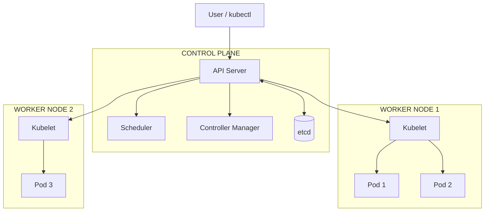

### Control Plane

Manages the Kubernetes cluster.

| Component | Responsibility |
|---|---|
| API Server | Entry point for Kubernetes requests |
| Scheduler | Selects a suitable Worker Node for new Pods |
| Controller Manager | Ensures the cluster matches the desired state |
| etcd | Stores cluster configuration and state |

### Worker Node

Runs the actual application workloads.

| Component | Responsibility |
|---|---|
| Kubelet | Ensures Pods are running as instructed |
| Container Runtime | Runs containers |
| Pods | Run application containers |

---

## 3. Kubernetes Core Resources

### Pod

A **Pod** is the smallest deployable unit in Kubernetes. It contains one or more containers.

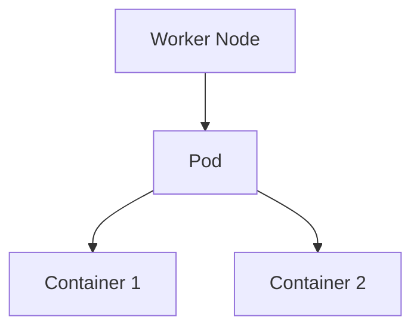

- Containers inside a Pod share networking.
- A Pod receives its own IP address.
- Pods are replaceable; their IP addresses can change.

### Deployment and ReplicaSet

A **Deployment** manages application updates and the desired number of Pod replicas.

A **ReplicaSet** ensures that the required number of Pods are running.

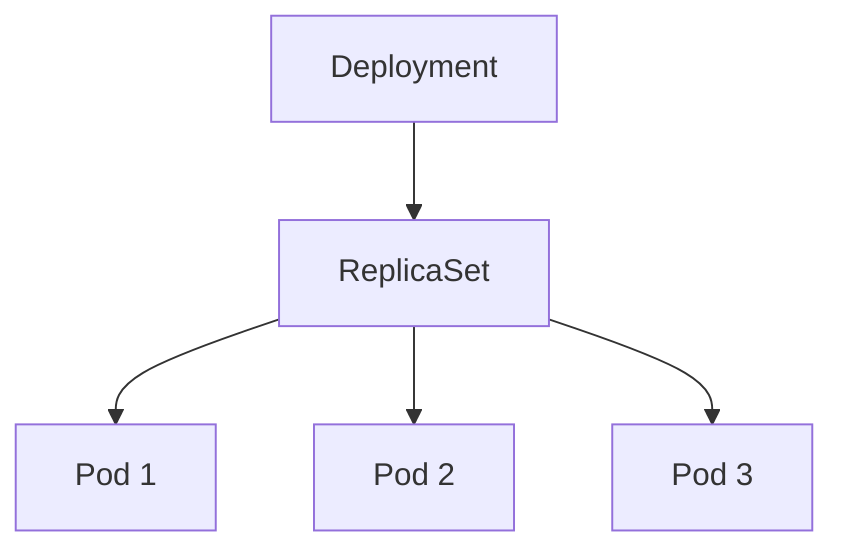

Example: If the desired replica count is 3, Kubernetes tries to maintain 3 running Pods.

If one Pod fails, the ReplicaSet creates a replacement.

---

## 4. Services and Networking

A **Service** provides a stable network endpoint for accessing a group of Pods.

Pod IP addresses can change, but the Service endpoint remains stable.

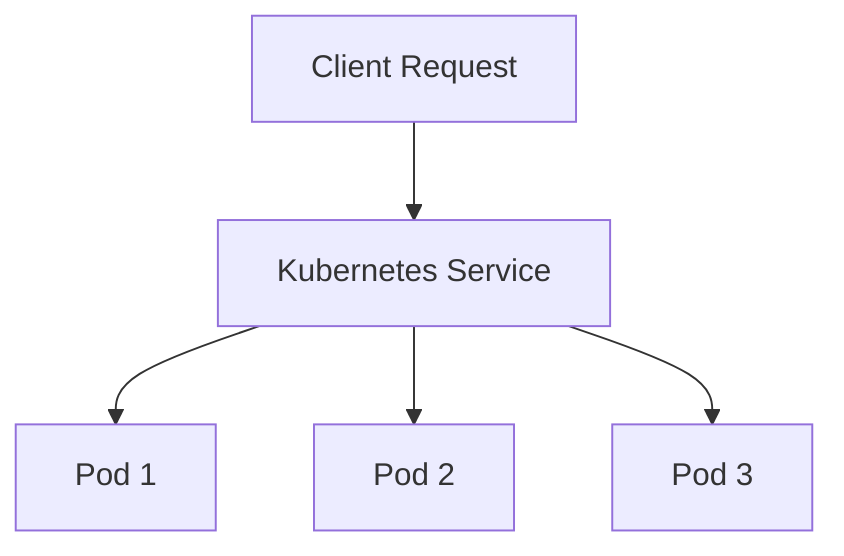

The Service selects Pods using labels and forwards traffic to eligible Pods.

### Types of Services

| Type | Purpose |
|---|---|
| ClusterIP | Internal access within the cluster |
| NodePort | Exposes the application through a node port |
| LoadBalancer | Exposes the application through an external load balancer |

For our ML API, `ClusterIP` is suitable for internal communication. External access can be provided through an appropriate ingress or load-balancing setup.

---

## 5. Scaling and Self-Healing

### Self-Healing

Kubernetes continuously checks whether the actual state matches the desired state.

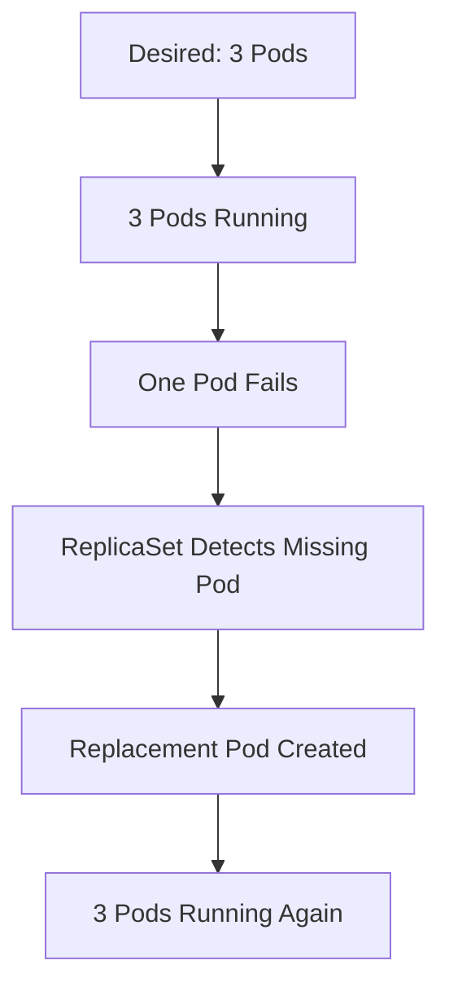

### Horizontal Pod Autoscaler (HPA)

HPA automatically increases or decreases the number of Pod replicas based on observed metrics.

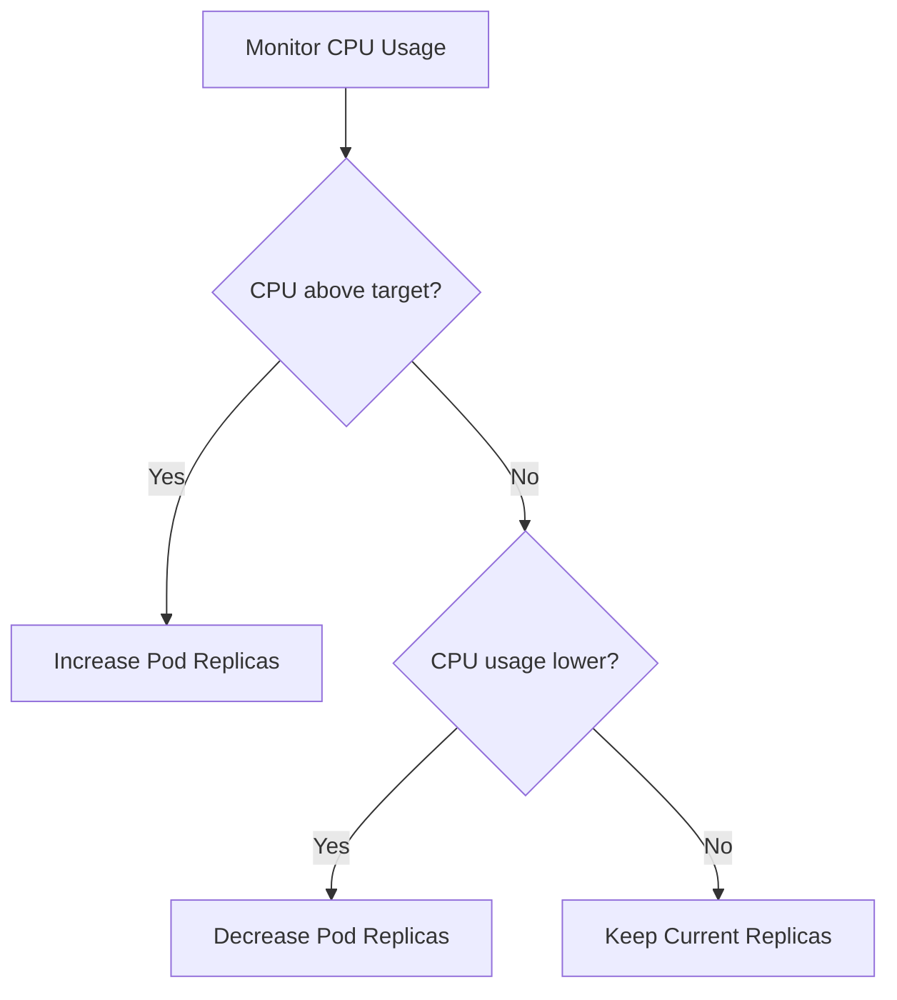

Example configuration:

- Minimum replicas: 2
- Maximum replicas: 5
- Target CPU utilization: 70%

HPA requires a working metrics source, such as Metrics Server. CPU utilization targets also require CPU requests to be configured.

---

## 6. Configuration and Storage

### ConfigMap

A **ConfigMap** stores non-sensitive application configuration separately from application code.

Examples:
- Application environment
- API port
- Model path

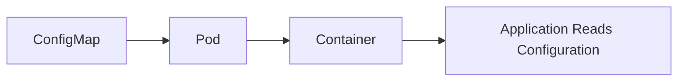

### Secret

A **Secret** stores sensitive information such as passwords, API keys, and tokens.

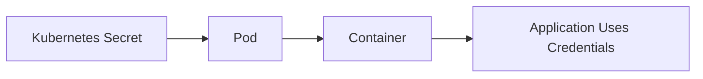

Secrets can be exposed to containers as environment variables or mounted files.

**Important:** Base64 encoding is not encryption. Secrets need appropriate access controls and encryption-at-rest protection.

### Persistent Volume (PV) and Persistent Volume Claim (PVC)

- **PV:** A storage resource available to the cluster.
- **PVC:** A request for storage made by an application.
- **StorageClass:** Defines how storage can be dynamically provisioned.

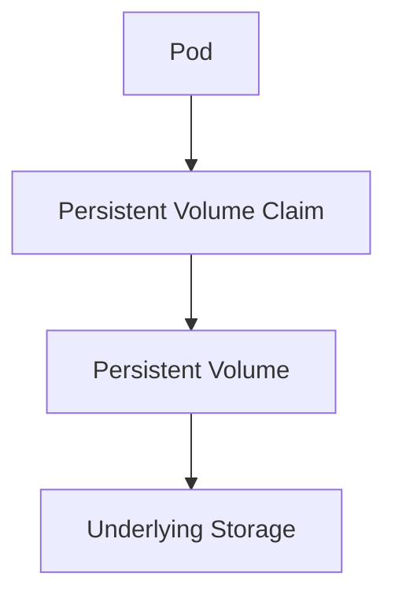

A Pod must mount the PVC to access the storage.

PV/PVC are useful when application data must survive Pod replacement. They are not automatically required for every ML API.

---

## 7. Production Concepts

### Liveness and Readiness Probes

Both probes check application health, but they serve different purposes.

| Probe | Purpose | On Failure |
|---|---|---|
| Liveness | Checks whether the container is healthy | Container can be restarted |
| Readiness | Checks whether the application can accept traffic | Pod is removed from Service endpoints |

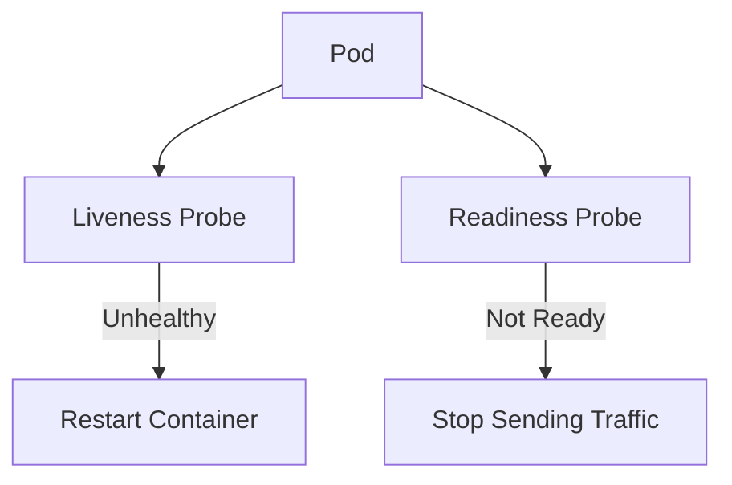

### Resource Requests and Limits

- **Requests:** Resources Kubernetes uses when scheduling a Pod.
- **Limits:** Maximum resources a container can consume.

Example:

```yaml
resources:
  requests:
    cpu: "250m"
    memory: "256Mi"
  limits:
    cpu: "500m"
    memory: "512Mi"
```

### Rolling Updates and Rollbacks

**Rolling Update:** Gradually replaces old application Pods with new ones.

**Rollback:** Returns a Deployment to a previous revision.

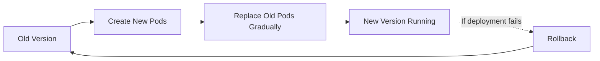

---

## 8. Complete ML Application Deployment Flow

This is how Kubernetes fits into our ML deployment project.

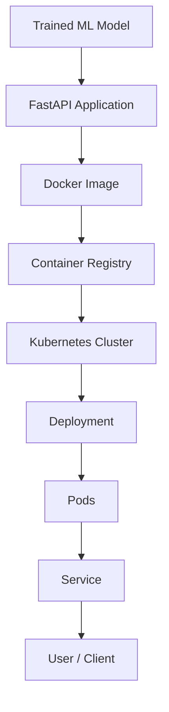

**Flow explanation:**

1. Train and package the ML model.
2. Build a Docker image containing the API, model, and dependencies.
3. Push the image to a container registry.
4. Kubernetes pulls the image from the registry.
5. A Deployment creates and manages Pods.
6. A Service provides a stable endpoint to access the API.
7. Kubernetes monitors and manages the application.

---

## 9. kubectl Commands

`kubectl` is the command-line tool used to communicate with the Kubernetes API Server.

| Command | Purpose |
|---|---|
| `kubectl get pods` | List Pods |
| `kubectl get deployments` | List Deployments |
| `kubectl get services` | List Services |
| `kubectl get nodes` | List Worker Nodes |
| `kubectl get namespaces` | List Namespaces |
| `kubectl apply -f deployment.yaml` | Create or update resources |
| `kubectl describe pod <pod-name>` | View Pod details |
| `kubectl logs <pod-name>` | View container logs |
| `kubectl delete -f deployment.yaml` | Delete resources defined in a file |
| `kubectl get hpa` | View autoscaler status |

---

## 10. Kubernetes Project Structure

```text
Week8_MLOps_HandsOn/
│
├── app/
│   └── main.py
│
├── artifacts/
│   └── packaged_model/
│
├── Dockerfile.fastapi
│
└── kubernetes/
    ├── namespace.yaml
    ├── deployment.yaml
    ├── service.yaml
    ├── configmap.yaml
    ├── secret.yaml
    ├── persistent-volume.yaml
    ├── persistent-volume-claim.yaml
    └── hpa.yaml
```

### Important

Not every Kubernetes resource is mandatory for every application.

| Resource | Purpose |
|---|---|
| Namespace | Organizes application resources |
| Deployment | Manages application Pods |
| Service | Provides stable networking |
| ConfigMap | Stores non-sensitive configuration |
| Secret | Stores sensitive configuration |
| PV/PVC | Provides persistent storage when needed |
| HPA | Automatically scales Pod replicas |

ConfigMaps, Secrets, and PVCs must be explicitly connected to the Deployment/Pods to be used. HPA requires metrics and appropriate resource requests.

---

## 11. What Kubernetes Does NOT Do

- It does not train ML models.
- It does not build Docker images.
- It does not automatically fix application bugs.
- It does not guarantee application security.
- It does not automatically create every required storage or networking resource.

**Kubernetes orchestrates containerized applications. It does not replace the tools used to build those applications.**

